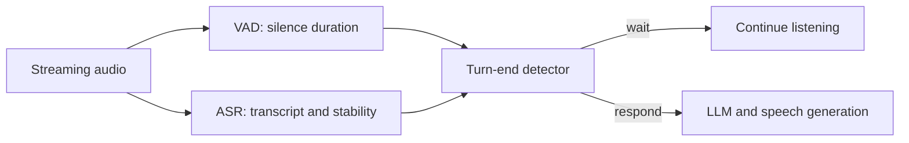

# Streaming Turn-End Detection

A compact English / experimental Spanish detector that decides whether a voice agent should **wait** or **respond**. It combines a streaming transcript, VAD silence duration, and ASR transcript stability using logistic regression and conservative timing gates.

This is a runnable engineering prototype trained on synthetic data, **not a production-validated detector**. It consumes text and timing metadata, not raw audio. See the [solution document](docs/assessment.md) for design choices, evaluation, limitations, and the proposed production monitoring plan.

## Quick start

Use Python 3.12 or newer. Run from the repository root:

```bash
python3 -m venv .venv
source .venv/bin/activate
python -m pip install -r requirements.txt
make test
make serve
```

The trained model is included, so retraining is optional. On Windows, activate with `.venv\Scripts\activate` and run `python -m unittest discover -s . -p "test_*.py" -v` and `python -m uvicorn turn_detector.service:app --host 0.0.0.0 --port 8000` directly.

Open [API documentation](http://localhost:8000/docs). In a second terminal, activate the environment and try:

```bash
python infer.py --text "That's all I needed, thanks." --pause-ms 850 --stability-ms 500
python infer.py --text "I need to reschedule because" --pause-ms 850 --stability-ms 500
python infer.py --text "Eso es todo, muchas gracias." --pause-ms 850 --stability-ms 500 --language es
```

These examples return `respond`, `wait`, and `respond`, respectively, with the included model.

## API and architecture



Only the detector is implemented here. The upstream and downstream components belong to the surrounding voice agent.

- `GET /health`: service health and model version.
- `POST /predict`: `text`, `pause_ms`, `stability_ms`, and optional `language`.
- Supported API language values: `en`, `en-US`, `en-GB`, `es`, `es-ES`, `es-419`.
- Response: `action`, `p_end`, `threshold`, `model_version`, and `reason_codes`.

For a JSON request example:

```bash
curl --fail http://localhost:8000/predict \
  -H 'Content-Type: application/json' \
  --data-binary @request.example.json
```

The policy always waits below 180 ms of silence or 100 ms of transcript stability. Otherwise, it compares the score against the validation-selected threshold of 0.58. The score is not calibrated for production calls. Set `TURN_MODEL_PATH` before service startup to use another model file.

## Training and tests

```bash
make train
make test
```

Training recreates `data/synthetic_turns.csv`, `artifacts/model.json`, and `artifacts/evaluation.json`. The corpus contains 3,040 snapshots from 38 synthetic templates. Templates stay within one split: 1,920 training, 560 validation, and 560 test examples. Threshold selection uses validation data and a 4:1 false-response/false-wait cost with the policy gates applied.

The seven standard-library unit tests cover timing gates, complete/open utterances, language handling, and response fields. `pytest` is optional: install it separately to run `python -m pytest -v test_detector.py`.

## Evaluation and performance

The served policy achieves **94.3% precision**, **75.4% recall**, and **0.838 F1** on the synthetic holdout. These scores demonstrate the pipeline; they do not establish real-call accuracy. See [evaluation JSON](artifacts/evaluation.json).

With a service running, measure local HTTP latency and throughput:

```bash
python bench.py --requests 1200 --concurrency 20
```

The [recorded Docker benchmark](artifacts/benchmark-docker.json) used 30 warm-up requests, 1,200 sequential requests, and 1,200 requests at 20-client concurrency:

| Mode | p50 | p95 | p99 | Throughput |
|---|---:|---:|---:|---:|
| Sequential | 0.904 ms | 1.009 ms | 1.152 ms | — |
| 20 concurrent clients | 9.088 ms | 11.818 ms | 13.394 ms | 2,134.53 requests/s |

These are short local Apple Silicon Mac measurements including HTTP/JSON overhead, using a repeated payload. They exclude ASR, deliberate silence waiting, external network, LLM, and TTS delays, and are not production capacity guarantees.

## Docker

With Docker running:

```bash
docker build -t happyrobot-eot .
docker run --rm --name happyrobot-eot -p 8000:8000 happyrobot-eot
```

The image serves one Uvicorn worker and includes a health check. Stop it with `docker stop happyrobot-eot`. Use either Docker or the local server on port 8000 at a time.

## Repository layout

```text
turn_detector/        features, model, synthetic generator, FastAPI service
train.py              reproducible training and held-out evaluation
infer.py              command-line API client
bench.py              sequential and concurrent HTTP benchmark
test_detector.py      behavior tests
artifacts/            included model and essential evaluation results
docs/assessment.md    solution, tradeoffs, monitoring, and next steps
```
